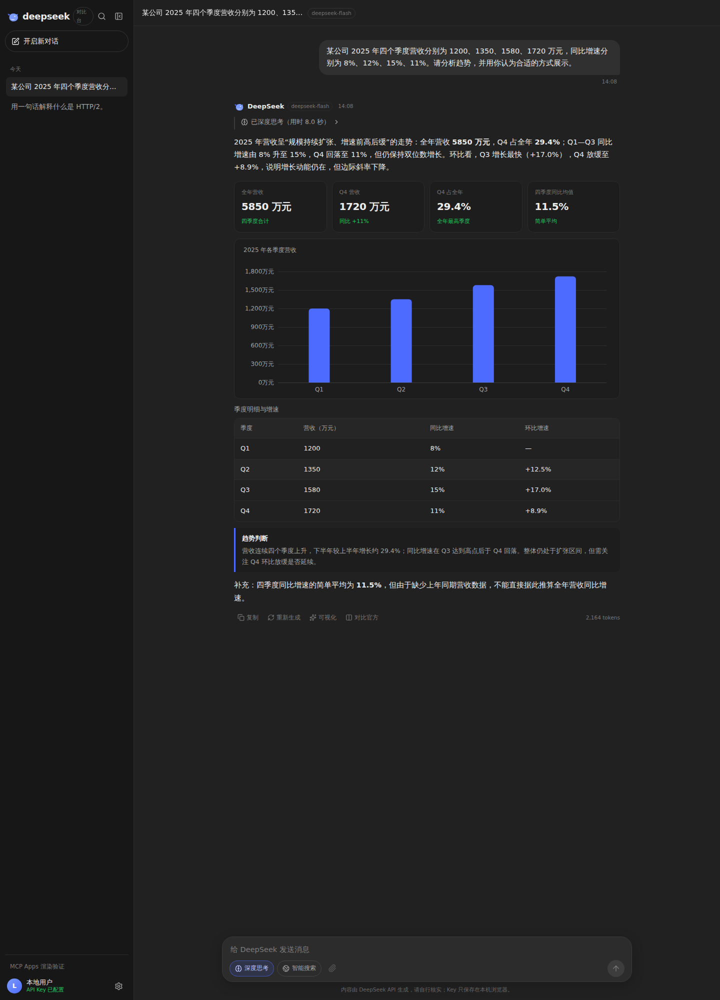
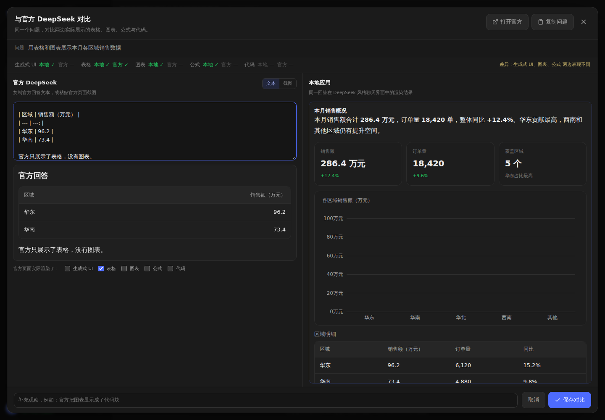

# DeepSeek 对比台 · MCP Apps Demo

一个本地运行的 DeepSeek 风格聊天应用：填入自己的 DeepSeek API Key 后对话，让模型根据内容自行决定用表格、图表、指标卡还是普通文字来呈现；同时提供一个 MCP Apps 端到端验证页，用来观察“同一个 MCP 结果，不同宿主为什么展示效果不同”。



## 项目定位

项目包含两个入口：

| 入口 | 说明 |
| --- | --- |
| `/` | DeepSeek 风格聊天台，支持流式回答、深度思考、官方 Search API、生成式 UI、与官方回答对比 |
| `/mcp-demo` | MCP Apps 验证页：MCP Server 声明 `ui://` 资源，宿主用官方 `AppBridge` 在沙箱 iframe 中渲染表格与图表 |

聊天台是主应用，MCP Apps 页面用于验证“富渲染宿主”的工作机制。

## 核心特点

### 1. 模型驱动的生成式 UI，不是写死的模板

宿主不再实现“检测到表格就自动加图表”这类硬编码规则。是否可视化、用什么组件、组件顺序，全部由模型根据内容决定。

模型可以在回答中输出一个 `ui` 代码块，内容是一段严格 JSON：

```json
{
  "blocks": [
    {
      "type": "metrics",
      "items": [
        { "label": "销售额", "value": "286.4 万元", "delta": "+12.4%", "tone": "up" }
      ]
    },
    {
      "type": "chart",
      "chart": {
        "type": "bar",
        "title": "各区域销售额",
        "x": "区域",
        "y": "销售额",
        "unit": "万元",
        "data": [{ "区域": "华东", "销售额": 96.2 }]
      }
    },
    {
      "type": "table",
      "columns": ["区域", "销售额"],
      "rows": [["华东", "96.2"]]
    },
    {
      "type": "callout",
      "tone": "warn",
      "title": "关注点",
      "text": "西南区域增速低于整体水平。"
    }
  ]
}
```

宿主只负责提供组件注册表和渲染，不替模型做内容决策。简单问题模型会保持普通 Markdown，不会强行套卡片。

当前组件：

| 组件 | 用途 | 关键字段 |
| --- | --- | --- |
| `metrics` | 关键指标卡 | `items[].label/value/delta/tone` |
| `chart` | 柱状图 / 折线图 / 饼图 | `chart.type/x/y/name/value/unit/data` |
| `table` | 结构化表格 | `title/columns/rows` |
| `callout` | 结论、提示、风险 | `tone/title/text` |
| `timeline` | 流程、阶段 | `items[].title/description/date` |
| `compare` | 双栏对比 | `left/right` 各含 `title/items` |
| `code` | 代码块 | `language/code` |
| `divider` | 分隔线 | — |

渲染器会尝试修复常见的 JSON 格式问题（多余逗号、外层代码围栏等），仍失败时展示错误卡片，不会让整个回答崩溃。

> 设计取舍：早期版本曾在表格下方自动生成图表。后来移除了这条规则——是否可视化、用什么组件，应该由模型根据内容判断；宿主只提供组件注册表，避免所有回答都被套成同一种样子。

### 2. DeepSeek 对话能力

- 流式 SSE 输出，支持中途停止
- 深度思考：展示 `reasoning_content` 与思考耗时
- 模型切换：`deepseek-flash` / `deepseek-v4-pro`
- 思考强度：`low` / `high` / `max`
- 智能搜索：调用 DeepSeek 官方 `/v1/tools/search`，展示来源标题、摘要和链接
- Markdown / GFM 表格 / 代码高亮与复制 / KaTeX 公式
- 会话历史按“今天 / 昨天 / 7 天内 / 30 天内 / 更早”分组，本地持久化

### 3. 与 DeepSeek 官方回答对比

DeepSeek 官方网页版没有公开 API，无法由程序直接调用，所以对比采用“官方回答回填”的方式：

1. 复制同一个问题到 `chat.deepseek.com`
2. 把官方回答文本粘贴进对比面板，或直接粘贴官方页面截图
3. 左右并排查看官方与本地渲染结果
4. 自动识别 **生成式 UI / 表格 / 图表 / 公式 / 代码** 是否出现
5. 官方侧可手动勾选“页面实际渲染了什么”，避免把代码块误判成图表



适合回答这个问题：**同样一个问题、同样的数据，官方是纯文本/表格，本地是否多渲染了图表或生成式组件？**

### 4. MCP Apps 验证页

`/mcp-demo` 不是聊天功能，而是一个协议级验证：

- 内置 MCP Server 注册工具 `sales_dashboard`
- 工具声明 `_meta.ui.resourceUri = ui://sales/dashboard.html`
- 资源 MIME 为 `text/html;profile=mcp-app`
- 本地宿主读取资源，通过官方 `AppBridge` 完成 `ui/initialize` 握手
- UI 在沙箱 iframe 中渲染，工具结果通过 `structuredContent` 注入
- 页面实时显示 `initialized → tool-input → tool-result → size-changed` 事件

这正是“同一个 MCP，宿主体验差异”的核心：MCP 协议本身不定义 UI，宿主是否实现 MCP Apps / 富渲染层，决定了最终看到的是 JSON、表格还是可交互图表。

## 快速开始

### 环境要求

- Node.js 20.19+ 或 22.12+（Vite 7 要求）
- pnpm
- 一个 DeepSeek API Key（[开放平台](https://platform.deepseek.com/)）

### 安装与启动

```bash
pnpm install
```

开发模式（Vite 前端 + 本地 API 服务）：

```bash
pnpm dev
# 打开 http://localhost:5173
```

生产构建模式：

```bash
pnpm start
# 打开 http://127.0.0.1:3080
```

启动后进入左下角「设置」：

1. 填入 DeepSeek API Key
2. 选择模型与思考强度
3. 点击「测试连接」确认可用
4. 保存后开始对话

也可以不填 Key，改由服务端环境变量提供：

```bash
DEEPSEEK_API_KEY=sk-... pnpm start
```

> 智能搜索会调用 DeepSeek Search API，按成功请求次数单独计费。

### 环境变量

| 变量 | 说明 |
| --- | --- |
| `DEEPSEEK_API_KEY` | 服务端 Key；浏览器设置留空时使用 |
| `DEEPSEEK_BASE_URL` | API 地址，默认 `https://api.deepseek.com` |
| `MOCK_DEEPSEEK=1` | 启用 Mock，不请求真实 API |

### 无 Key 体验界面（Mock 模式）

```bash
MOCK_DEEPSEEK=1 pnpm start
```

Mock 模式会返回一段包含指标卡、图表、表格、结论卡的固定流式回答，用于验证 UI 和渲染链路，不会请求真实 API。

## 使用方式

- **普通提问**：模型自行决定用 Markdown 还是生成式 UI
- **深度思考**：输入框左下角开启，回答上方会显示思考过程
- **智能搜索**：开启后先检索网页，再基于搜索结果回答，并在回答下方展示来源
- **可视化**：任意回答下方的「可视化」按钮会让模型把原回答重排成更易读的表格/图表/卡片版本
- **对比官方**：回答下方「对比官方」打开对比面板，粘贴官方回答或截图
- **历史会话**：左侧按日期分组，支持搜索、删除、切换
- **MCP Apps 验证**：侧边栏底部「MCP Apps 渲染验证」进入 `/mcp-demo`

## 项目结构

```text
mcp-apps-demo/
├── src/
│   ├── main.ts          # HTTP 服务：静态资源、聊天/搜索代理、MCP API
│   ├── server.ts        # 演示用 MCP Server（sales_dashboard + ui:// 资源）
│   ├── mock.ts          # Mock SSE、Mock 搜索
│   └── widget/          # MCP App 的 HTML 看板
├── web/
│   ├── index.html
│   └── src/
│       ├── App.tsx              # 会话状态、发送、重新生成、对比
│       ├── api.ts               # SSE 解析、搜索、模型连接测试
│       ├── constants.ts         # 系统提示词（生成式 UI 协议）
│       ├── components/
│       │   ├── Markdown.tsx     # Markdown/代码/公式/图表分发
│       │   ├── GenerativeUI.tsx # 生成式 UI 组件注册表与渲染
│       │   ├── ChartBlock.tsx   # ECharts 图表
│       │   ├── ComparePanel.tsx # 官方对比面板
│       │   ├── ChatView.tsx     # 消息流与输入区
│       │   └── ...
│       └── styles.css
├── host/                  # MCP Apps 本地宿主页面
├── scripts/
│   ├── verify.ts          # MCP Apps 协议 + 渲染验证
│   ├── verify-chat.ts     # 聊天应用 Playwright 验证
│   └── browser.ts         # 本地 Chromium 启动辅助
└── docs/                  # README 截图
```

## 可用脚本

| 命令 | 作用 |
| --- | --- |
| `pnpm dev` | 同时启动 API（3080）和 Vite（5173） |
| `pnpm dev:server` | 只启动 Node 服务 |
| `pnpm dev:web` | 只启动 Vite |
| `pnpm build` | 构建前端与 MCP 宿主 |
| `pnpm start` | 构建后以 3080 端口运行 |
| `pnpm verify:chat` | Playwright 验证聊天、生成式 UI、搜索、对比、持久化 |
| `pnpm verify` | 验证 MCP Apps 协议与沙箱渲染 |
| `pnpm typecheck` | TypeScript 类型检查 |

### 验证说明

- `pnpm verify:chat`：13 项检查，使用 Mock 数据，不需要真实 Key
- `pnpm verify`：12 项检查，覆盖 `tools/list`、`resources/read`、`tools/call` 与浏览器端 iframe 渲染
- 两个脚本都会用 Playwright 截图到 `artifacts/`

如果系统缺少 Chromium 运行库或中文字体，`scripts/browser.ts` 会自动使用项目根目录 `.browser-libs/` 下的本地库和字体；该目录已被 `.gitignore` 忽略，不随仓库分发。普通环境安装 Chromium 后可直接运行：

```bash
npx playwright-core install chromium
```

## HTTP 接口

| 方法 | 路径 | 说明 |
| --- | --- | --- |
| GET | `/api/config` | 是否配置服务端 Key、是否 Mock 模式 |
| GET | `/api/models` | 代理 DeepSeek 模型列表，用于连接测试 |
| POST | `/api/chat` | 代理 DeepSeek Chat Completions，SSE 流式返回 |
| POST | `/api/search` | 代理 DeepSeek Search API |
| GET | `/api/tools` | 演示 MCP Server 的工具列表 |
| POST | `/api/call` | 调用演示 MCP 工具 |
| POST | `/api/read` | 读取 MCP `ui://` 资源 |

聊天请求的 Key 通过 `x-deepseek-key` 请求头传给本地服务，服务端仅用于转发，不写盘、不记录日志。

## 安全与隐私

- API Key 保存在浏览器 `localStorage`，每次请求通过请求头传给本地代理
- 服务端不保存 Key，不主动打印请求头
- 会话历史保存在浏览器 `localStorage`
- 官方对比截图压缩后保存在浏览器 IndexedDB
- 没有用户系统、没有云端同步，所有数据都在本机

注意：`localStorage` 对同源脚本可见，不建议在不受信任的电脑上使用真实 Key。

## 已知限制

- **官方对比是手动的**：`chat.deepseek.com` 没有公开 API，且需要登录，无法自动抓取官方回答
- **文本不会逐字一致**：官方网页有隐藏系统提示词、联网搜索、不同采样参数；对比重点是渲染能力与交互差异
- **模型可能不遵守 `ui` 协议**：模型偶尔会退回普通 Markdown；渲染器会做 JSON 修复和错误兜底
- **图表数据由模型提供**：没有数据时模型不应编造图表，但实际输出仍需人工核对
- **文件上传暂未实现**：输入框附件按钮目前为禁用状态
- **会话只在本机**：清空浏览器存储会丢失历史
- **搜索单独计费**：Search API 与模型 token 分开计费

## 技术栈

- React 19 + Vite 7 + TypeScript
- Node.js HTTP Server + `tsx`
- `@modelcontextprotocol/server` / `client` / `ext-apps`
- ECharts 6（SVG renderer）
- `react-markdown` + `remark-gfm` + `remark-math` + `rehype-katex` + `rehype-highlight`
- Playwright（端到端验证）

## 参考

- [DeepSeek API 文档](https://api-docs.deepseek.com/zh-cn/)
- [DeepSeek 思考模式](https://api-docs.deepseek.com/zh-cn/guides/thinking_mode)
- [DeepSeek 网页搜索与抓取](https://api-docs.deepseek.com/zh-cn/guides/search)
- [MCP Apps SDK](https://github.com/modelcontextprotocol/ext-apps)
- [Model Context Protocol](https://modelcontextprotocol.io/)
